# Parent Portal Comprehensive Operational & UI/UX Audit Plan

## Program Overview
- **Portal Under Audit**: Parent Portal (`/parent`)
- **Core Directives**:
  - Full end-to-end inspection: UI/UX ergonomics, design tokens, responsive layouts, copywriting standards (`AGENTS.md` Rule 1 & Rule 2), button interactions, modal forms, backend API query scoping, and cross-portal data flow.
  - Multi-child testing: Test guardian experience for both single-child and multi-child families (active child switcher, separate tuition statements, individualized academic reports, distinct gate security pickup PINs).
  - Absolute zero-placeholder standard: Zero mock scores, zero fake standing (`2nd of 38`), zero compound slashes/ampersands, and elimination of generic visual clutter.
  - Defect logging: All discovered bugs, API contract discrepancies, and UI flaws will be cataloged immediately in [`QA_FLAWS_AND_DEFECTS_REGISTER.md`](file:///c:/Users/USER/.gemini/antigravity-ide/brain/d91f51eb-0149-4924-b2e1-64b0c18033a4/QA_FLAWS_AND_DEFECTS_REGISTER.md).

---

## Multi-Child Parent Persona Strategy

> [!IMPORTANT]
> **Database Audit Finding**:
> An inspection of all 15 guardian records in PostgreSQL revealed that **zero parents currently have more than 1 child linked in `student_guardians`** (every guardian has exactly 1 child, and two have 0).

To fulfill the requirement to test when a parent has more than 1 child, we propose two official testing personas:

1. **Persona 1: Single-Child Guardian**
   - **Parent**: **Chief Emeka Okafor** (`emeka.okafor@gmail.com`, Password: `Oakland@2026`)
   - **Child**: **Chiamaka Okafor** (Class: JSS 1, Admission No: `OAK-2026-760`)
   - **Purpose**: Verify standard single-child parent navigation, dashboard quick metrics, tuition balance calculation, and gate dismissal records.

2. **Persona 2: Multi-Child Guardian (Two Children in Different Classes)**
   - **Parent**: **Alhaji Bello** (`bello.amina@gmail.com`, Password: `Oakland@2026`)
   - **Proper Channel Linking**: In PostgreSQL, link Alhaji Bello to his two real children currently enrolled in Oakland School:
     - Child 1: **Ibrahim Bello** (Class: JSS 1, Admission No: `OAK-2026-891`)
     - Child 2: **Aisha Bello** (Class: SS 3, Admission No: `OAK-2026-802`)
   - **Purpose**: Test the sidebar active student switcher dropdown, state persistence across page transitions, class-specific tuition rates (JSS ₦1,250,000 vs SS 3 ₦1,550,000), separate report cards, and unique gate security pickup authorizations.

---

## 4-Batch Route Breakdown

```mermaid
graph TD
    subgraph "Batch 1: Family Overview & Multi-Child Roster"
        B1_Dash["Dashboard (/parent)"] --> B1_Kids["My Children (/parent/children)"]
    end

    subgraph "Batch 2: Academic Performance & Broadsheets"
        B2_Res["Academic Results (/parent/results)"]
    end

    subgraph "Batch 3: Administration, Finances & Gate Security"
        B3_Fees["Tuition & Fees (/parent/fees)"] --> B3_Pick["Pickup & Escorts (/parent/pickup)"]
    end

    subgraph "Batch 4: Community, Notices & Guardian Identity"
        B4_Comm["School Notices (/parent/communications)"] --> B4_Cal["Academic Calendar (/parent/calendar)"]
        B4_Cal --> B4_Prof["Guardian Profile (/parent/profile)"]
    end
```

---

### BATCH 1: Family Overview & Multi-Child Roster (STATUS: COMPLETED ✅)
**Target Routes (2):**
- [`/parent`](http://localhost:3000/parent) — Executive Parent Dashboard
- [`/parent/children`](http://localhost:3000/parent/children) — Registered Children Directory & Correction Desk

#### Execution & Findings:
- **Multi-Child Persona Setup**: Linked registered parent **Alhaji Bello** (`bello.amina@gmail.com` / `Oakland@2026`) to real enrolled students **Ibrahim Bello** (JSS 1, `OAK-2026-891`) and **Aisha Bello** (SS 3, `OAK-2026-802`) via PostgreSQL `student_guardians`.
- **Active Child Context Switching**: Verified seamless context switching via both sidebar dropdown and hero horizontal child selector pills. Active context instantly updates across `ParentContext`, persists to `localStorage.oakland_active_child_id`, and correctly switches between Ibrahim (JSS 1 attendance rate 0.0%) and Aisha (SS 3 attendance rate —).
- **Executive Dashboard Metrics**: Dynamic tuition cards resolve correctly from `finances.settings`. Invariant checks: zero fake averages, zero uncomputed standings.
- **My Children & Correction Workflow**: Tested "Set as Active" and "Request Profile Correction" form (dispatched to `/api/communications`, modal auto-dismissed after success toast).
- **Logged Defects**:
  - **DEF-071 (High)**: Security Incident Escalations and Other Students' CBT Marks Leaking into Parent Notices
  - **DEF-072 (Medium)**: Hardcoded "Authorized" Dismissal Clearance on My Children Cards
  - **DEF-073 (Low)**: Missing Spacing and Formatting in Class / Department Header (`SS 3Sciences`)
  - **DEF-074 (Low)**: Single-Line Text Input for Profile Correction Reason
  - **DEF-075 (Low)**: Past Calendar Events Displayed Under Parent Dashboard Upcoming Schedule
  - **DEF-076 (Low)**: Mobile Sub-44px Touch Targets on Parent Portal Sidebar Navigation
  - **DEF-077 (Low)**: Mismatched Button Heights & Redundant Status Tag on My Children Card

---

### BATCH 2: Academic Performance & Broadsheets (STATUS: COMPLETED ✅)
**Target Route (1):**
- [`/parent/results`](http://localhost:3000/parent/results) — Terminal Academic Broadsheets & Report Cards

#### Execution & Findings:
- **Dual-Viewport & Persona Testing**: Tested on both Desktop (1280×800) and Mobile (375×812). Tested multi-child persona (Alhaji Bello switching between Ibrahim Bello JSS 1 and Aisha Bello SS 3) and single-child persona (Chief Emeka Okafor / Chiamaka Okafor JSS 1).
- **Zero-Mock Empty State Fidelity**: Displayed clean empty state *"No Published Results Yet • First Term examination scores for [Class] are currently undergoing academic collation and executive endorsement."* Clean zero-placeholder display without mock grades or fake standings.
- **Contract Disconnect Discovery**: Discovered that `/parent/results/page.tsx` calls `/api/results` without `?studentId=...` and looks for non-existent top-level property `isPublished` and array `studentReports`, preventing real report cards from ever displaying even after endorsement.
- **Logged Defects**:
  - **DEF-078 (High)**: Parent Results Desk Contract Disconnect Prevents Report Cards from Displaying
  - **DEF-079 (Medium)**: Fabricated Mock Remark Fallback on Subject Scores (`Satisfactory`)
  - **DEF-080 (Low)**: Missing Horizontal Scroll Cue & Sticky Subject Column on Mobile Broadsheet Table
  - **DEF-081 (Low)**: Stale Generic Emerald Pill Token in Report Card Grade Badges

---

### BATCH 3: Administration, Finances & Gate Security (STATUS: COMPLETED ✅)
**Target Routes (2):**
- [`/parent/fees`](http://localhost:3000/parent/fees) — Bursary Ledger, Invoices & Payment Receipts
- [`/parent/pickup`](http://localhost:3000/parent/pickup) — Gate Security, 4-Digit PIN & Authorized Escort Roster

#### Execution & Findings:
- **Dual-Viewport & Persona Testing**: Tested on Desktop (1280×800) and Mobile (375×812) across multi-child persona Alhaji Bello (Ibrahim Bello JSS 1, Aisha Bello SS 3) and single-child persona Chief Emeka Okafor (Chiamaka Okafor JSS 1).
- **Tuition Billing Substring Inversion Bug**: Discovered that `.includes('SS 1')` in `parent/fees/page.tsx:57` evaluates to `true` for `'JSS 1'` and `'JSS 2'`, erroneously assessing Junior Secondary students at Senior Secondary rates (₦220,000 instead of ₦180,000) while the balance card correctly displays ₦180,000, creating an overt mathematical contradiction.
- **Official 4-Digit Pickup PIN Security**: Verified unmasked/masked eye toggle and confirmed PINs resolve strictly from PostgreSQL `student_guardians.pickup_pin` (`4821` for Ibrahim Bello, `5914` for Aisha Bello).
- **Authorized Escort Registration**: Submitted modal form to register a new escort ("Mallam Usman Bello", Relative, `+2348039876543`) for Aisha Bello; verified backend insertion in PostgreSQL with an auto-generated PIN `2689` and instant reactivity updating the escort count from 2 to 3 while strictly preserving student foreign key isolation (did not appear under Ibrahim Bello).
- **Logged Defects**:
  - **DEF-082 (High)**: Substring Matching Inversion in Tuition Rates Misclassifies JSS Students as SS 1/SS 2
  - **DEF-083 (Medium)**: Sub-44px Mobile Touch Targets on Gate Dismissal Actions (WCAG 2.5.8)
  - **DEF-084 (Low)**: Generic Emerald Pill Badges on Authorized Escorts & Gate Dismissal Logs
  - **DEF-085 (Medium)**: Prohibited Placeholder Fallback Dates and Fallback Admission Codes in Fee Statements

---

### BATCH 4: Community, Notices & Guardian Identity (STATUS: COMPLETED ✅)
**Target Routes (3):**
- [`/parent/communications`](http://localhost:3000/parent/communications) — Official School Notices & Bulletins
- [`/parent/calendar`](http://localhost:3000/parent/calendar) — Academic Calendar & Institutional Dates
- [`/parent/profile`](http://localhost:3000/parent/profile) — Guardian Identity, Contacts & Account Security

#### Execution & Findings:
- **Dual-Viewport & Persona Testing**: Tested on Desktop (1280×800) and Mobile (375×812) across multi-child persona Alhaji Bello and single-child persona Chief Emeka Okafor.
- **School Notices & Data Leakage**: Search query filtering and reading modal verified. Confirmed critical defect **DEF-071** where physical security incident escalations, CBT submissions, and other students' gate passes leak into the parent communications feed. Discovered that the "Urgent Updates" tab checks ad-hoc `subject.includes('urgent')` rather than the notice's true `priority` or `severity` (**DEF-086**).
- **Academic Calendar Synchronization**: Discovered that category filter tabs ("Parent Consultations" & "Examinations") check `evType === 'meeting'` and `evType === 'academic'`, whereas PostgreSQL stores `type = 'pta'` and `type = 'sports'`, causing category filter buttons to permanently show empty states (**DEF-087**). Also found past events (11 Oct 2026) displayed with "Confirmed" upcoming badges without chronological partitioning.
- **Guardian Profile & Password Security**: Personal contact details and linked students roster (Ibrahim Bello & Aisha Bello) verified. Form validation catches password mismatches and eye toggle unmasks both inputs. Verified that `PATCH /api/auth/me` successfully updates credentials, but invalidates the session without issuing replacement cookies or redirecting, trapping the user in a broken session (**DEF-088**). Tested "Sign Out" button which cleanly terminates the session and redirects to `/login`. Restored password to official default `Oakland@2026`.
- **Logged Defects**:
  - **DEF-086 (Medium)**: Ad-Hoc Substring Filter on School Notices Ignores Broadcast Priority & Severity
  - **DEF-087 (Medium)**: Academic Calendar Category Filters Mismatched with Database Event Types
  - **DEF-088 (High)**: Password Update Invalidates Session Without Refreshing Token or Redirecting to Login

---

## Universal Invariants & Standards Checklist

| Standard | Rule Reference | Target Requirement |
| :--- | :--- | :--- |
| **Zero Mock Data** | Rule 1 | Zero hardcoded scores, zero fake standings (`2nd of 38`), zero fallback arrays (`SAMPLE_CHILDREN`). |
| **Master Settings Dynamic Resolution** | Rule 1.3 | Tuition dynamically resolved from `schools.settings` (`tuitionJSS`, `tuitionSS12`, `tuitionSS3`). |
| **Clean Empty States** | Rule 1.4 | Unsubmitted scores render `—` or *"Scores Pending"*. Zero records show clean empty notices. |
| **Copywriting Standard** | Rule 2.1 | Ban compound slashes/ampersands (`/`, `&`). Use clean words: `Tuition`, `Guardian`, `Role`. |
| **Vocabulary Cleanliness** | Rule 2.2 | Ban dramatic/filler words (`dossier`, `mandate`, `cohort`). |
| **Visual Clutter Purge** | Rule 2.3 | Ban meaningless badges (`Verified`, `WAEC Accredited`, redundant active tags). |
| **Gate Security Standard** | Rule 5 & 10 | Simple 4-digit Pickup PIN strictly from PostgreSQL `student_guardians.pickup_pin`. |
| **Default Password Standard** | Rule 6 | Accounts default to `Oakland@2026` with unmasked copy and eye toggle. |

---

## Execution Deliverables
1. **Audit Register Updates**: Every flaw, API discrepancy, and UI defect will be logged in [`QA_FLAWS_AND_DEFECTS_REGISTER.md`](file:///c:/Users/USER/.gemini/antigravity-ide/brain/d91f51eb-0149-4924-b2e1-64b0c18033a4/QA_FLAWS_AND_DEFECTS_REGISTER.md) with unique IDs.
2. **Visual Evidence**: Playwright browser screenshots captured at key checkpoints.
3. **Batch Progress Reports**: Comprehensive summaries delivered batch-by-batch upon user approval.
