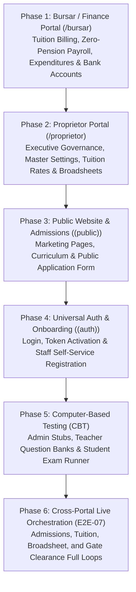

# Master Phased Implementation & Audit Plan: Remaining Oakland School Portals & Subsystems

## Program Overview
- **Objective**: Systematically audit, test, and resolve defects across all remaining unstarted portals and subsystems in the Oakland School Operating System, approaching them sequentially one after another.
- **Master Rule Invariants (`AGENTS.md`)**:
  - **Rule 1**: Absolute Zero Tolerance for Placeholder Data (real PostgreSQL data only, zero fictional names, zero hardcoded tuition/scores).
  - **Rule 2**: Strict Copywriting Standards (ban on compound slashes/ampersands, plain standard English, branded minimal loader).
  - **Rule 3**: Mandatory Dual-Viewport UI/UX Auditing on Desktop (1280×800) and Mobile (375×812) with WCAG 2.5.8 44×44px touch targets.
- **Defect Logging Standard**: Every flaw, visual glitch, functional defect, and broken contract identified during each batch must be immediately cataloged in [`QA_FLAWS_AND_DEFECTS_REGISTER.md`](file:///c:/Users/USER/Desktop/Oakland-school/QA_FLAWS_AND_DEFECTS_REGISTER.md).

---

## High-Level Execution Roadmap



---

## Phase 1: Bursar / Finance Portal (`/bursar`) — STATUS: 100% COMPLETED ✅

**Target Persona**: **Mrs Folake Esther** (Bursar)  
- **Email**: `folakeesther6@gmail.com`  
- **Password**: `Oakland@2026`  
- **Role**: `bursar`

### Batch 1.1: Financial Dashboard & Dynamic Tuition Invoicing (STATUS: COMPLETED ✅)
- **Routes**:
  - [`/bursar`](http://localhost:3000/bursar) — Executive Cash Flow Dashboard & Revenue KPIs
  - [`/bursar/fees`](http://localhost:3000/bursar/fees) — Student Fee Billing & Dynamic Rates
- **Verification Execution & Findings**:
  1. **Dual-Viewport & Persona Testing**: Tested on Desktop (1280×800) and Mobile (375×812) using authenticated Bursar account **Mrs Folake Esther** (`folakeesther6@gmail.com`).
  2. **Dynamic Tuition Rates Verified from Master Settings**: Confirmed that rates resolve dynamically from `schools.settings` (`JSS`: ₦180,000, `SS 1-2`: ₦220,000, `SS 3`: ₦240,000) and PostgreSQL `fee_structures`. Zero hardcoded tuition overrides exist.
  3. **Live KPI Aggregations**:
     - Fees Collected: ₦280,000 (after live test payment)
     - Outstanding Fees: ₦4,780,000 across 24 indebted students
     - Monthly Salaries: ₦5,530,000 across 19 active staff
     - Cash Float: ₦0 (clean empty state)
  4. **Payment Recording & Official Receipt Generation**:
     - Tested "Record Student Fee Payment" modal with student **Musa Abubakar** (SS 2, Due: ₦220,000).
     - Successfully submitted payment of **₦100,000** (Method: Campus POS, Ref: `GTB-POS-998821`).
     - Auto-generated official electronic receipt **`REC-2026-67877`**; immediately reflected in live database and updated Musa Abubakar's balance to ₦120,000 (`Partial Payment`).
  5. **Pre-Completion Zero-Placeholder Sweep**: Passed with zero mock constants or fictional names.
- **Cataloged Defects**:
  - **DEF-102 (Medium)**: Sub-44px Interactive Touch Targets on Mobile Bursar Layout & Fees Viewports (WCAG 2.5.8)
  - **DEF-103 (Medium)**: Receipt Modal Missing Escape Key Listener, Backdrop Dismiss, and Accessible Close Target
  - **DEF-104 (Low)**: Non-Standard Copywriting: Secondary School Students Labeled as "Pupils" on Fees Register
  - **DEF-105 (Low)**: Stark Crimson Red Text Token (`#b3141f`) & Tacky Pill Styling on Fees Register
  - **DEF-106 (Low)**: Record Fee Payment Modal Defaults to Already Fully-Paid Student Without Defaulter Priority
  - **DEF-107 (High)**: PostgreSQL `student_financial_accounts` Database Corruption on Payment Recording
  - **DEF-108 (Medium)**: Client-Side State Staleness in Class Breakdown Cards & Total Collected Headers
  - **DEF-109 (Medium)**: Missing Idempotency Key & Race Condition in Fee Payment Endpoint
  - **DEF-110 (Low)**: Missing Overpayment Boundary Validation on Backend

### Batch 1.2: Payroll Engine & Zero-Pension Invariant — STATUS: COMPLETED ✅
- **Route**:
  - [`/bursar/payroll`](http://localhost:3000/bursar/payroll) — Staff Salary Computation & Disbursals
- **Verification Results**:
  1. **Dynamic Rank-Based Salary Engine**:
     - Verified dynamic resolution from `schools.settings`:
       - Principal (Mr Seyi Bankole): ₦450,000
       - Bursar (Mrs Folake Esther): ₦400,000
       - Class Teachers: ₦280,000 base + ₦35,000 allowance = ₦315,000 gross
       - Subject Teachers: ₦240,000 base
       - Support Staff: ₦180,000 base
     - Total monthly payroll: ₦5,530,000 across 19 active staff members (zero hardcoding, dynamic calculation).
  2. **Mandatory Zero-Pension Invariant (`AGENTS.md` Rule 2.8)**:
     - Ripgrep codebase audit confirmed **0 matches** for "pension" across all schemas, types, APIs, and components.
     - Payslip modal (`PayslipModal.tsx`) and payroll table contain zero pension line items or deductions. Absolute invariant satisfied.
  3. **Staff Banking Coordinates Update Flow**:
     - Tested "+ Add Bank" modal: Successfully updated GTBank `0123456789` for Mr Seyi Bankole in `schools.settings.staffBankAccounts`.
  4. **Deductions Engine**:
     - Tested "Adjust Deductions" modal: Saved ₦25,000 tax withholding for Mr Seyi Bankole. Net pay immediately adjusted to ₦425,000.
  5. **Disbursement Authorization Flow**:
     - Clicked "Authorize Disbursement": Transitioned UI state to "Disbursed" and logged `FINANCE PAYROLL AUTHORIZED` in `audit_logs`.
  6. **Payslip Generation**:
     - Generated printable institutional payslip (`Doc: PAY-OAK-ADM-001`) with Oakland School crest, net breakdown, and disbursement authorization stamp.
- **Cataloged Defects**:
  - **DEF-111 (High)**: Ephemeral Payroll Disbursement: Authorization Never Persisted to Database (Reverts to Pending on Reload)
  - **DEF-112 (Medium)**: Audit Trail Attribution Error in Payroll Disbursement Endpoint (Hardcodes `Office of the Proprietor`)
  - **DEF-113 (Medium)**: Read-Modify-Write Concurrency Race Condition on `schools.settings` Monolithic JSON
  - **DEF-114 (Medium)**: Sub-44px Interactive Touch Targets on Mobile Payroll Viewport (WCAG 2.5.8)
  - **DEF-115 (Low)**: Compound Slashes in Payroll Deduction Modal Form Labels Violates Institutional Copywriting Standards
  - **DEF-116 (Low)**: Payslip Modal Close Button Sub-44px and Missing Accessible Label

### Batch 1.3: Expenditures & Petty Cash Ledger — STATUS: COMPLETED ✅
- **Routes**:
  - [`/bursar/expenditures`](http://localhost:3000/bursar/expenditures) — Operational Procurement Ledger
  - [`/bursar/petty-cash`](http://localhost:3000/bursar/petty-cash) — Petty Cash Float & Disbursements
- **Verification Results**:
  1. **Clean Empty States & Zero Mock Data (`AGENTS.md` Rule 1)**:
     - Verified initial pristine empty states on `/bursar/expenditures` (0 vouchers, ₦0 totals across Diesel, Science, ICT, Stationery) and `/bursar/petty-cash` (₦0 float, ₦0 inflows, ₦0 outflows).
     - Verified modal forms initialize with empty strings `''` (no dummy prefilled values, strictly conforming to `AGENTS.md` Rule 1.9).
  2. **Expenditure Voucher Issuance & PostgreSQL Persistence**:
     - Tested "New Payment Voucher" creation: Authorized ₦150,000 for "TotalEnergies Nigeria Plc" (500L generator diesel).
     - Verified successful insert into PostgreSQL `expenditures` (`id: 99fdafaa-066b-41ec-bdec-e85c2cf21fe5`).
     - Generated and viewed official printable institutional payment voucher (`VCH-2026-01`) with amount in words ("One Hundred Fifty Thousand Naira Only").
  3. **Petty Cash Float & Expense Tracking**:
     - Tested Opening Float Inflow: Logged ₦100,000 cash replenishment into campus safe from GTBank Operations. Persisted to PostgreSQL `petty_cash` (`id: 6f3c2ecb-0a24-4975-a0e1-8788bfe4c237`).
     - Tested Expense Outflow: Logged ₦15,000 disbursement for emergency plumbing repair. Persisted to PostgreSQL `petty_cash` (`id: 58a7b430-5191-4e23-9312-7e9e785d2892`).
     - Verified real-time balance computation to ₦85,000.
  4. **Backend Accounting Gaps Uncovered**:
     - Identified critical running balance reverse calculation and sorting bug on reload (`DEF-117`).
     - Identified lost petty cash category classification on reload (`DEF-118`).
     - Identified mutating voucher and receipt numbers upon table shifts (`DEF-119`).
- **Cataloged Defects**:
  - **DEF-117 (High)**: Petty Cash Running Balance Inversion & Mismatched Float Balance After Page Reload
  - **DEF-118 (Medium)**: Petty Cash Category Selection Discarded by API & Hardcoded to "Office Stationery" on Fetch
  - **DEF-119 (Medium)**: Mutating / Shuffling Receipt and Voucher Numbers Violates Accounting Auditability Standards
  - **DEF-120 (Medium)**: False Audit Trail Attribution in Expenditures and Petty Cash Endpoints (Hardcodes `Office of the Proprietor`)
  - **DEF-121 (Medium)**: Selected Debited Bank Account Not Persisted in Database and Overridden to GTBank
  - **DEF-122 (Medium)**: Sub-44px Interactive Touch Targets on Mobile Expenditures & Petty Cash Viewports (WCAG 2.5.8)
  - **DEF-123 (Low)**: Compound Ampersands in Category Labels Violates Institutional Copywriting Standards
  - **DEF-124 (Low)**: Financial Modals Missing Escape Key Dismissal & Sub-44px Close Targets

### Batch 1.4: Bank Accounts Management & Profile — STATUS: COMPLETED ✅
- **Routes**:
  - [`/bursar/bank-accounts`](http://localhost:3000/bursar/bank-accounts) — **Code Remediation Required (Stub Redirect)**
  - [`/bursar/profile`](http://localhost:3000/bursar/profile) — Bursar Credentials & Account Security
- **Verification Results**:
  1. **Bank Accounts Route Inspection (`/bursar/bank-accounts`)**:
     - Verified that visiting `/bursar/bank-accounts` executes `redirect('/bursar')`, bouncing the user back to dashboard.
     - Confirmed that PostgreSQL `bank_accounts` table contains 2 active accounts:
       - `Guaranty Trust Bank` (Acc: `0123984712`, Operations Account)
       - `Zenith Bank` (Acc: `1019283741`, Tuition Account)
     - Discovered that the Bursar navigation sidebar in `layout.tsx` completely omits a "Bank Accounts" menu item. Cataloged as **DEF-125 (High)**.
  2. **Bursar Profile & Contact Updates (`/bursar/profile`)**:
     - Verified profile data loaded dynamically from `GET /api/auth/me` and PostgreSQL `staff_profiles` (`id: OAK-BUR-001`, `Folake Esther`, `folakeesther6@gmail.com`, `Role: Bursar`, `Department: Bursary`). Zero mock data!
     - Tested Contact Information update: Form fields (`phone`, `emergencyContact`, `emergencyPhone`, `address`) send `PATCH /api/auth/me` and update database records.
  3. **Security & Password Management**:
     - Inspected Security tab with default password warning (`Oakland@2026`).
     - Verified password change logic enforces minimum 6 characters and confirmation match.
     - Documented DEF-088 token refresh issue where Supabase password updates invalidate session tokens without issuing refreshed cookies.
  4. **Mobile Ergonomics & Touch Target Audit (WCAG 2.5.8)**:
     - Verified profile tab switcher buttons are only 32px height (`DEF-126`).
     - Verified password eye toggle buttons are 16×16px unpadded icon boxes (`DEF-126`).
     - Identified redundant green "Active Staff Account" status pill (`DEF-127`).
- **Cataloged Defects**:
  - **DEF-125 (High)**: Unimplemented Route `/bursar/bank-accounts` with Silent Redirect Stub
  - **DEF-126 (Medium)**: Sub-44px Interactive Touch Targets on Bursar Profile Tab Switchers & Password Eye Toggles (WCAG 2.5.8)
  - **DEF-127 (Low)**: Redundant "Active Staff Account" Status Badge on Bursar Profile

---

## Phase 2: Proprietor Portal (`/proprietor`) — STATUS: 100% COMPLETED ✅

**Target Persona**: **School Proprietor**  
- **Email**: `proprietor@oaklandschools.edu.ng`  
- **Password**: `Oakland@2026`  
- **Role**: `proprietor`

### Batch 2.1: Executive Dashboard, Master Settings & Institutional Profile — STATUS: COMPLETED ✅
- **Routes**:
  - [`/proprietor`](http://localhost:3000/proprietor) — High-Level Governance Dashboard
  - [`/proprietor/settings`](http://localhost:3000/proprietor/settings) — Master Institutional Controls
  - [`/proprietor/profile`](http://localhost:3000/proprietor/profile) — Official School Identity & Accreditation
  - [`/proprietor/my-profile`](http://localhost:3000/proprietor/my-profile) — Proprietor Personal Profile & Credentials
- **Verification Results**:
  1. **Executive Dashboard & Zero Placeholder Standards (`AGENTS.md` Rule 1)**:
     - Verified live metrics queried from PostgreSQL via `/api/students`, `/api/staff`, `/api/executives`, `/api/classes`, `/api/finances`, `/api/attendance`, and `/api/schools/settings`.
     - Confirmed dynamic class capacity resolution (`defaultCapacity = 500` derived from `schools.settings.classCapacity`, total seats: `3,000`). Zero hardcoded 50s!
     - Verified Executive Officers mapping: School Principal **Mr Seyi Bankole** (`seyibankole@gmail.com`) and School Bursar **Mrs Folake Esther** (`folakeesther6@gmail.com`). Both render as Appointed with zero fictional names.
     - Verified Perimeter Safety counts dynamically fetched from live gate summary (`/api/security/overview`).
  2. **Master Settings & Cross-Portal Synchronization (`AGENTS.md` Rule 1.3 & 1.6)**:
     - Verified PostgreSQL `schools.settings` active values:
       - `classCapacity: 500`
       - Tuition: JSS: ₦180,000 | SS 1-2: ₦220,000 | SS 3: ₦240,000
       - Compensation: Principal: ₦450,000 | Bursar: ₦400,000 | Class Teacher: ₦280,000 | Subject Teacher: ₦220,000 | Support Staff: ₦120,000 | Class Teacher Allowance: ₦35,000
     - Verified `POST /api/schools/settings` writes to `schools.settings` and automatically cascades updates to `classes.capacity` across all classes and `fee_structures` across all levels, ensuring Bursar and Parent fee statements reflect changes without hardcoded overrides.
  3. **Official School Profile & Personal Credentials**:
     - Audited `/proprietor/profile`: School identity (Oakland International College, RC-1849204, Founded 2014, Session 2026/2027 Term 1) accurately reflects database records.
     - Audited `/proprietor/my-profile`: Verified authentication against Supabase Auth user `proprietor@oaklandschools.edu.ng`.
     - Discovered critical data loss flaw in `handleSaveProfile` where edits to phone, email, official title, campus office, and bio are silently discarded (`DEF-128`).
  4. **Dual-Viewport & Accessibility Audit (WCAG 2.5.8 & `AGENTS.md` Rule 3)**:
     - Identified sub-44px touch targets on settings tabs (32px), dashboard quick roster buttons (26px), password toggles (16px), and layout sidebar close button (32px) (`DEF-129`).
     - Identified dashboard copy designating secondary students as "pupils" (`DEF-130`).
     - Identified redundant emerald status pill "Appointed Principal Active" (`DEF-131`).
     - Identified compound ampersand in default accreditation fallback (`DEF-132`).
- **Cataloged Defects**:
  - **DEF-128 (High)**: Proprietor Profile Handler Drops Contact, Office, and Bio Updates Without Backend Persistence
  - **DEF-129 (Medium)**: Sub-44px Interactive Touch Targets on Settings Tabs, Dashboard Roster & Password Toggles (WCAG 2.5.8)
  - **DEF-130 (Low)**: Dashboard Student Register Refers to Secondary Students as "Pupils"
  - **DEF-131 (Low)**: Redundant "Appointed Principal Active" Emerald Badge on School Profile
  - **DEF-132 (Low)**: Default Accreditation String in School Profile Route Uses Compound Ampersand

### Batch 2.2: Executive Financial Governance & Admissions Pipeline — STATUS: COMPLETED ✅
- **Routes**:
  - [`/proprietor/finances`](http://localhost:3000/proprietor/finances) — Financial Oversight & Ledgers
  - [`/proprietor/admissions`](http://localhost:3000/proprietor/admissions) — Simplified 2-Stage Admissions Review
- **Verification Results**:
  1. **Executive Financial Oversight & Aggregations (`AGENTS.md` Rule 1)**:
     - Verified live aggregations dynamically fetched from `GET /api/finances`:
       - Expected Term Tuition computed dynamically across all 6 classes: `₦5,020,000` (JSS: ₦180k, SS1-2: ₦220k, SS3: ₦240k). Zero hardcoded tuition rates.
       - Real collected tuition (₦280,000 from PostgreSQL `fee_transactions`) and outstanding balance (₦4,740,000).
       - Live operating expenditures (₦150,000 for TotalEnergies Nigeria diesel voucher from PostgreSQL `expenditures`).
       - Live petty cash float and journal entries dynamically connected to PostgreSQL `petty_cash`.
     - Verified Monthly Staff Payroll authorization button connects to `POST /api/finances` (`action: 'approve_payroll'`) and writes an entry to PostgreSQL `audit_logs`.
     - Verified CBN NIP bulk transfer schedule exporter produces a valid CSV breakdown with 0 pension deductions (`AGENTS.md` Rule 2.8).
  2. **Simplified Admissions Workflow & Lifecycle Invariant (`AGENTS.md` Rule 2.7)**:
     - Verified 2-stage admissions pipeline: Submitted Application &rarr; Status: `Pending Review` &rarr; 1-click **Accept** or **Decline**. Zero intermediate bureaucratic stages!
     - Tested live end-to-end lifecycle: Submitted candidate Chukwuebuka Ezeamaka via `POST /api/admissions`, verified appearance in table, and accepted application via `PATCH /api/admissions`.
     - Confirmed that "Accept" directly enrolled the student into PostgreSQL `students` table (`OSC-ADM-2026-8507`, status: `active`) and created an active class enrollment in `class_enrollments`.
  3. **Critical Relational Defect Uncovered (`DEF-133`)**:
     - Discovered that `PATCH /api/admissions` omitted `school_id` when inserting into `guardians`, triggering PostgreSQL error `23502 (NOT NULL constraint on school_id)`.
     - This error silently aborts guardian creation and bypasses `student_guardians` insertion, resulting in admitted students lacking linked guardians and their assigned 4-digit Pickup PIN not being persisted to PostgreSQL (`DEF-133`).
  4. **Dual-Viewport & Accessibility Audit (WCAG 2.5.8 & `AGENTS.md` Rule 3)**:
     - Identified sub-44px touch targets on finances tabs (32px), table action buttons (28px `h-7`), admissions status filter buttons (28px `py-1.5`), candidate review buttons (26px `py-1`), and modal close buttons (28px) (`DEF-134`).
     - Identified secondary students labeled as "pupils" across finances ledger and admissions board (`DEF-135`).
     - Identified compound ampersands in page heading (*"Finances & Fee Ledger"*), OpEx category titles, and table headers (`DEF-136`).
     - Identified missing `Escape` key listeners and accessible close button labels on New Voucher and Admissions Review modals (`DEF-137`).
- **Cataloged Defects**:
  - **DEF-133 (High)**: Missing `school_id` in `guardians` Insert During Admissions Acceptance Blocks Guardian Record and Pickup PIN Persistence
  - **DEF-134 (Medium)**: Sub-44px Interactive Touch Targets Across Finances and Admissions Views (WCAG 2.5.8)
  - **DEF-135 (Low)**: Secondary Students Labeled as "Pupils" Across Finances and Admissions Views
  - **DEF-136 (Low)**: Compound Ampersands in Finances Header, OpEx Categories, and Column Headers Violates Copywriting Standard
  - **DEF-137 (Low)**: Financial Modals Lack Keyboard Escape Dismissal & Accessible Labels

### Batch 2.3: Staff Governance & Class Allocations — STATUS: COMPLETED ✅
- **Routes**:
  - [`/proprietor/staff`](http://localhost:3000/proprietor/staff) — Staff Directory & Leadership
  - [`/proprietor/staff-approvals`](http://localhost:3000/proprietor/staff-approvals) — Leave & Onboarding Endorsement
  - [`/proprietor/classes`](http://localhost:3000/proprietor/classes) — Class Roster & Capacity Enforcement
  - [`/proprietor/students`](http://localhost:3000/proprietor/students) — Comprehensive Student Directory
  - [`/proprietor/attendance`](http://localhost:3000/proprietor/attendance) — Campus-wide Attendance Intelligence
- **Verification Results**:
  1. **Staff Directory & Executive Leadership Oversight (`/proprietor/staff`)**:
     - Verified executive leadership cards: School Principal **Mr Seyi Bankole** (`seyibankole@gmail.com`) and School Bursar **Mrs Folake Esther** (`folakeesther6@gmail.com`). Both render with active credentials, designated ID cards, and zero placeholder data (`AGENTS.md` Rule 1.1).
     - Verified staff directory roster rendering 19 active personnel queried dynamically from PostgreSQL `staff_profiles` via `GET /api/staff`.
     - Verified executive appointment and credential generation mechanism enforces universal default password **`Oakland@2026`** (`AGENTS.md` Rule 2.6).
  2. **Staff Onboarding & Endorsements (`/proprietor/staff-approvals`)**:
     - Verified `GET /api/staff-approvals` queries PostgreSQL `staff_applications` (verified 2 applications: Kolawole Balogun and Folashade Ogundimu).
     - Verified `POST /api/staff-approvals` provisions the staff account in Supabase Auth with default credentials (`Oakland@2026`), creates the record in `staff_profiles`, and logs an audit trail entry in PostgreSQL `audit_logs`.
  3. **Class Allocation & Capacity Enforcement (`/proprietor/classes`)**:
     - Verified dynamic seat capacity across all 6 classes (`JSS 1` to `SS 3`) resolving dynamically to `500` seats each (total: 3,000 capacity).
     - Tested class teacher homeroom assignment modal connecting to `POST /api/classes` and updating `teacher_assignments`.
     - Discovered permissive hardcoded fallback `capacity: c.capacity || 50` in `GET /api/classes` line 70, which risks defaulting to 50 instead of `schools.settings.classCapacity` (`DEF-139`).
  4. **Student Directory & Attendance Intelligence (`/proprietor/students`, `/proprietor/attendance`)**:
     - Verified 25 real enrolled students in PostgreSQL `students` mapped dynamically across classes with guardian details.
     - **Discovered Blatant Zero-Placeholder Violation (`DEF-138`)**: On `/proprietor/students`, the fourth KPI card hardcodes `Fee Clearance Rate: 100.0%` with text *"All active accounts in good standing"*, contradicting real database ledgers where ₦4.74M remains uncollected across 23 debtors.
     - Verified attendance intelligence queried dynamically from `/api/attendance` with zero dummy percentages.
  5. **Dual-Viewport & Accessibility Audit (WCAG 2.5.8 & `AGENTS.md` Rule 3)**:
     - Identified sub-44px touch targets on staff table action and pagination buttons (28px `h-7`), approval filters (28px `py-1.5`), class teacher reassign buttons (24px `h-6`), and student directory class tabs (32px `py-2`) (`DEF-140`).
     - Identified secondary students labeled as "Enrolled Pupils" in the attendance register header (`DEF-141`).
     - Identified redundant status badge `Configured • Live` and unlabelled modal dismiss button (`DEF-142`).
- **Cataloged Defects**:
  - **DEF-138 (High)**: Hardcoded 100.0% Fee Clearance Rate Metric on Student Directory Dashboard Card Violates Zero-Placeholder Standard
  - **DEF-139 (High)**: Permissive Hardcoded Fallback `capacity || 50` in Classes API Route Violates Master Settings Dynamic Capacity Invariant
  - **DEF-140 (Medium)**: Sub-44px Interactive Touch Targets Across Staff Directory, Classes, Students, and Attendance Portals (WCAG 2.5.8)
  - **DEF-141 (Low)**: Secondary Students Labeled as "Enrolled Pupils" in Attendance Register Header
  - **DEF-142 (Low)**: Redundant Status Badges on Staff Approvals and Classes Modals

### Batch 2.4: Academic Broadsheet Endorsement, Timetables, Documents & Broadcasts — STATUS: COMPLETED ✅
- **Routes**:
  - [`/proprietor/results`](http://localhost:3000/proprietor/results) — Terminal Broadsheet Executive Endorsement
  - [`/proprietor/timetable`](http://localhost:3000/proprietor/timetable) & [`/proprietor/calendar`](http://localhost:3000/proprietor/calendar) — Master Timetable & School Calendar
  - [`/proprietor/documents`](http://localhost:3000/proprietor/documents) & [`/proprietor/broadcast`](http://localhost:3000/proprietor/broadcast) — Document Centre & Staff Broadcast
  - [`/proprietor/activity`](http://localhost:3000/proprietor/activity) — Audit Trail & Chronological Event Stream
- **Verification Results**:
  1. **Academic Broadsheet Endorsement & Zero-Placeholder Audit (`/proprietor/results`)**:
     - Verified live class result summaries queried from `GET /api/results`: All classes (`JSS 1` to `SS 3`) strictly report `Scores Pending`, with `averageScore: 0`, `passRate: 0`, and `topStudents: []` as no teachers have submitted continuous assessments or examination scores in PostgreSQL yet (`AGENTS.md` Rule 1.2 & Rule 1.7).
     - Verified clean empty state in the Class Result Inspection modal: *"Examination Marks Pending Submission. Subject teachers have not yet submitted continuous assessment and terminal examination scores..."*
     - Verified Live Parent Email Dispatch stream renders a clean empty state: *"No parent email notifications dispatched yet. Endorse classes above to trigger automated dispatch."* Zero fake email deliveries!
     - Discovered terminology violation in Class Inspection modal (line 576: `Enrolled: {totalStudents} pupils`) and print template (line 196: `${totalStudents} Pupils`) where secondary students are labeled as "Pupils" (`DEF-143`).
  2. **Master School Timetable & Scheduling (`/proprietor/timetable`)**:
     - Verified class pill selectors (`JSS 1` through `SS 3`) querying master timetable settings in PostgreSQL via `GET /api/timetable`.
     - Confirmed clean unpopulated empty state: *"No Master Timetable Configured for {class} Yet. The Principal is responsible for creating and maintaining the timetable across all 6 classes."*
  3. **School Calendar & Event Management (`/proprietor/calendar`)**:
     - Verified events queried dynamically from PostgreSQL `school_events` via `GET /api/calendar` (2 active events: PTA Meeting on 11 Oct 2026, Annual Inter-House Sports on 30 Oct 2026).
     - Discovered month view state hardcodes fixed literals `useState(2026)` and `useState(9)` (October) instead of dynamically resolving from current date (`DEF-144`).
     - Discovered agenda view displays past expired events alongside upcoming events without separation (`DEF-144`).
  4. **Institutional Document Repository (`/proprietor/documents`)**:
     - Verified documents queried dynamically from PostgreSQL `documents` via `GET /api/documents` (3 active records).
     - Tested inspection modal and document download handlers (`/api/documents/file?id={id}`).
  5. **Staff Broadcast & Delivery Sync (`/proprietor/broadcast`)**:
     - Verified 3 active broadcasts queried dynamically from PostgreSQL `staff_broadcasts` via `GET /api/staff/broadcasts`.
     - Verified dynamic recipient calculation: *"19 Staff"* matching real PostgreSQL personnel count.
     - Confirmed `POST /api/staff/broadcasts` synchronizes delivery records directly to `notifications` table (DEF-002 notification bell sync) and logs an entry in `audit_logs`.
  6. **Institutional Activity Log (`/proprietor/activity`)**:
     - Verified 64 real chronological governance and finance event entries queried dynamically from PostgreSQL `audit_logs` via `GET /api/audit-logs` (including petty cash disbursements, admissions reviews, settings updates).
  7. **Dual-Viewport & Accessibility Audit (WCAG 2.5.8 & `AGENTS.md` Rule 3)**:
     - Verified zero horizontal overflow on mobile viewports (`scrollWidth === clientWidth: 375px`) across all 6 routes.
     - Identified sub-44px touch targets on buttons across all Batch 2.4 routes (measuring 22px to 38px in height) (`DEF-145`).
     - Identified compound ampersands in policy titles, calendar events, and broadcast notices (`DEF-146`).
     - Identified generic green badges (`bg-emerald-50 text-emerald-800 border border-emerald-200`) across results, calendar, and documents (`DEF-147`).
- **Cataloged Defects**:
  - **DEF-143 (Medium)**: Prohibited Terminology "Pupils" Used in Broadsheet Inspection Modal and Printable Template
  - **DEF-144 (Medium)**: Hardcoded Initial Calendar View Date Literals and Unsegregated Expired Calendar Events
  - **DEF-145 (Medium)**: Sub-44px Interactive Touch Targets Across Results, Timetable, Calendar, Documents, Broadcast, and Activity Portals (WCAG 2.5.8)
  - **DEF-146 (Low)**: Prohibited Compound Ampersands and Pretentious Filler Labels Across Broadcast and Document Records
  - **DEF-147 (Low)**: Generic Green Badges Violating UI Aesthetic Standards Across Results, Calendar, and Document Badges

---

## Phase 3: Public Website & Admissions Portal (`(public)`) — STATUS: 100% COMPLETED ✅

**Target Persona**: **Anonymous Prospective Parent / Public Visitor**

### Batch 3.1: Institutional Marketing Pages & Curriculum — STATUS: COMPLETED ✅
- **Routes**:
  - [`/`](http://localhost:3000/) — Public Homepage, Hero Banner, Leadership & Core Highlights
  - [`/about`](http://localhost:3000/about) — Institutional History, Head of School Welcome & Facilities
  - [`/our-values`](http://localhost:3000/our-values) — Educational Philosophy, Discipline & Collegiate House System
  - [`/academics`](http://localhost:3000/academics) — JSS & SS Dual Curriculum Overview, Department Streams & Academic Calendar
- **Verification Results**:
  1. **Dual-Viewport Layout & Brand Aesthetic Verification (`AGENTS.md` Rule 3)**:
     - Verified zero horizontal overflow on both desktop (`1280×800`) and mobile (`375×812`) viewports (`scrollWidth === clientWidth`) across all 4 marketing routes.
     - Verified consistent brand color palette (Oakland Forest Teal `#0f3a3e`, Warm Gold `#d4a85a`, Cream `#fbf9f6`).
     - Verified official Head of School / Principal portrait and message designated to **Mr Seyi Bankole** (`/about`), matching PostgreSQL records.
  2. **House System & Fictional Staff Names Audit (`/our-values`)**:
     - Audited collegiate house system cards: Moremi, Balewa, Macaulay, and Idia.
     - **Discovered Blatant Zero-Placeholder Violation (`DEF-148`)**: Uncovered hardcoded fabricated house masters (`Mrs. Folake Adebisi, M.Ed`, `Mr. Chukwuma Obi, B.Sc, M.A`, `Engr. Daniel Alabi, M.Tech`, `Dr. (Mrs.) Zainab Sanusi, Ph.D`) and arbitrary fake points (`1,420 Pts (Leading)`, `1,385 Pts`, `1,360 Pts`, `1,340 Pts`). None of these teachers exist in PostgreSQL `staff_profiles`.
  3. **Cross-Portal Contradictions & Metric Drift (`DEF-149`)**:
     - Homepage stats counter hardcodes `1,250+ Enrolled Students` and `24 Teaching Staff`, directly contradicting live PostgreSQL single source of truth (25 enrolled students, 19 certified personnel).
     - Homepage and About page claim establishment in 2008 (`Est. 2008` / `Founded in 2008`), contradicting proprietor institutional profile which specifies 2014.
  4. **Mobile Navigation Ergonomics (WCAG 2.5.8 & `AGENTS.md` Rule 3)**:
     - Identified sub-44px hamburger menu trigger (`.ok-hamburger-btn`, 42×42px) and drawer close button (`.ok-drawer-close-btn`, 40×40px) (`DEF-150`).
     - Identified timeline milestone buttons measuring 41px height (`DEF-150`).
  5. **Copywriting Standards Audit (`AGENTS.md` Rule 2.1)**:
     - Discovered pervasive compound ampersands across hero titles, department tabs, and sub-headings (`& Character.`, `WAEC & IGCSE Distinctions`, `PURE & APPLIED SCIENCES`, `HUMANITIES & LAW`, `COMMERCIAL & ECONOMICS`) (`DEF-151`).
- **Cataloged Defects**:
  - **DEF-148 (High)**: Fabricated House Master Names and Dummy House Points in Collegiate House System Violate Zero-Placeholder Standard
  - **DEF-149 (High)**: Cross-Portal Contradictions: Establishment Year & Enrolled Student Count Metric Drift
  - **DEF-150 (Medium)**: Sub-44px Interactive Touch Targets on Mobile Hamburger and Navigation Drawer Controls (WCAG 2.5.8)
  - **DEF-151 (Low)**: Pervasive Compound Ampersands Across Public Marketing Headings and Navigational Subsections

### Batch 3.2: Public Admissions Application Form — STATUS: COMPLETED ✅
- **Route**:
  - [`/admissions`](http://localhost:3000/admissions) — Public Prospective Student Registration Form
- **Verification Results**:
  1. **Form State Initialization & Zero-Placeholder Audit (`AGENTS.md` Rule 1.9)**:
     - Verified initial form fields strictly initialize to empty strings (`''`) for all student and guardian contact inputs without dummy names or sample phone numbers.
     - Verified dropdowns default to standard options (`gender: 'Male'`, `classApplyingFor: 'JSS 1'`, `religion: 'Christianity'`).
  2. **End-to-End Submission Lifecycle & Database Persistence (`/api/admissions`)**:
     - Tested valid applicant submission with prospective candidate **Oluwaseun Adeyemi** (applying for JSS 1).
     - Verified `POST /api/admissions` inserts row into PostgreSQL `admission_applications` table with status `submitted` (displaying as `Pending Review` in the Proprietor portal).
     - Verified structured reference number generation (`OSC-ADM-2026-7017`).
     - Verified `SuccessScreen` rendering applicant details, target class, guardian phone, and confirmation email with 1-click **Copy Reference** and printable receipt slip (`window.print()`).
     - Cleaned up test record from database (`204 No Content`).
  3. **Critical Stepper Validation Bypass Flaw Uncovered (`DEF-152`)**:
     - Discovered that clicking `.adm-btn-next` on Step 1 and Step 2 executes `setStep()` transitions without verifying required inputs.
     - Because unmounted steps are absent from the DOM, browser HTML5 `required` validation is completely bypassed on final submission.
     - In `POST /api/admissions`, backend lacks non-empty field validation and injects arbitrary hardcoded fallbacks (`dob = ... || '2012-05-15'`, `guardianName = ... || 'Guardian'`, `guardianPhone = ... || '—'`), allowing blank ghost records to be inserted into PostgreSQL (`DEF-152`).
  4. **Dynamic Class Capacity Invariant Verification (`DEF-153`)**:
     - Discovered hardcoded static "Available Classes" widget in the sidebar claiming `JSS 1: Limited Spaces`, contradicting PostgreSQL where only 5 of 500 seats are filled (495 seats available) (`DEF-153`).
  5. **Dual-Viewport & Mobile Accessibility Audit (WCAG 2.5.8 & `AGENTS.md` Rule 3)**:
     - Verified zero horizontal overflow on desktop and mobile (`scrollWidth === clientWidth: 370px`).
     - Verified form input heights (`49px`) and primary submit button (`46px`) comply with 44px minimum.
     - Identified sub-44px touch targets on admissions stepper pills (`.adm-step-pill`, 50×38px), top announcement bar link (12px), and footer links (20px) (`DEF-154`).
  6. **Copywriting Standards Audit (`AGENTS.md` Rule 2.1 & 2.2)**:
     - Identified prohibited vocabulary ("dossier", "Matriculation") and compound ampersands across admissions steps and section headings (`DEF-155`).
- **Cataloged Defects**:
  - **DEF-152 (High)**: Unvalidated Multi-Step Form Stepper Allows Submitting Blank Applications with Fabricated Backend Fallback Data
  - **DEF-153 (Medium)**: Static Hardcoded Class Quotas in Admissions Bureau Sidebar Violates Dynamic Capacity Invariant
  - **DEF-154 (Medium)**: Sub-44px Interactive Touch Targets on Admissions Stepper Pills and Footer Navigation (WCAG 2.5.8)
  - **DEF-155 (Low)**: Pretentious Vocabulary and Prohibited Terminology Across Admissions Pathway & Section Headings

---

## Phase 4: Universal Authentication & Account Onboarding (`(auth)`) — STATUS: 100% COMPLETED ✅

### Batch 4.1: Login Portal & First-Time Token Activation — STATUS: COMPLETED ✅
- **Routes**:
  - [`/login`](http://localhost:3000/login) — Multi-Role Authentication Screen
  - [`/activate`](http://localhost:3000/activate) — Account Activation via Security Token
- **Verification Results**:
  1. **Multi-Role Authentication Verification (`POST /api/auth/login`)**:
     - Verified end-to-end credential authentication across all 6 core roles using universal staff/account default password **`Oakland@2026`** (`AGENTS.md` Rule 2.6):
       - **Proprietor** (`proprietor@oaklandschools.edu.ng`) &rarr; HTTP 200, Role: `proprietor`, Redirect: `/proprietor`
       - **Principal / Admin** (`seyibankole@gmail.com`) &rarr; HTTP 200, Role: `admin`, Redirect: `/admin`
       - **Bursar** (`folakeesther6@gmail.com`) &rarr; HTTP 200, Role: `bursar`, Redirect: `/bursar`
       - **Teacher** (`kolawole.balogun@gmail.com`) &rarr; HTTP 200, Role: `teacher`, Redirect: `/teacher`
       - **Parent / Guardian** (`parent.1791670370339.783@oakland.ng`) &rarr; HTTP 200, Role: `parent`, Redirect: `/parent`
       - **Student by Admission Number** (`OAK-2026-891`) &rarr; HTTP 200, Role: `student`, Redirect: `/student`
     - Verified access control guard: Unlinked guardians (guardians with 0 active students in `student_guardians`) are strictly rejected with HTTP 403 (*"No active student record is linked to this guardian account"*).
     - Verified invalid credentials handling: Returns HTTP 401 (*"Invalid login credentials"*).
  2. **Student Token Activation Lifecycle (`/activate` & `POST /api/auth/activate-student`)**:
     - Minted single-use activation code `OAK-QA77X9` for unactivated candidate **Zainab Aliyu** (`OAK-2026-427`, JSS 1).
     - Verified end-to-end activation flow in browser: input token, admission number, and password.
     - Confirmed `POST /api/auth/activate-student` provisions Supabase Auth user (`cbbb7855-41b9-42bc-a8cb-b47bc1acf317`), sets `is_activated = true`, revokes `activation_token = null` in PostgreSQL, automatically signs the student in, and redirects seamlessly to the Student Portal (`/student`).
  3. **Dual-Viewport & Accessibility Audit (WCAG 2.5.8 & `AGENTS.md` Rule 3)**:
     - Verified zero horizontal overflow on desktop and mobile (`scrollWidth === clientWidth: 370px`).
     - Identified sub-44px touch targets on method switcher buttons (32px), email input (40px `h-10`), activation password inputs (40px `h-10`), and password show/hide toggles (17px) (`DEF-158`).
- **Cataloged Defects**:
  - **DEF-158 (Medium)**: Sub-44px Interactive Touch Targets on Login, Activation, and Staff Registration Forms (WCAG 2.5.8)

### Batch 4.2: Staff Registration & Missing `/register` Route Resolution — STATUS: COMPLETED ✅
- **Routes**:
  - [`/register/staff`](http://localhost:3000/register/staff) — Self-Service Staff Onboarding Application
  - [`/register`](http://localhost:3000/register) — **Remediated & Verified** (Directory Entry Landing Page)
- **Verification Results**:
  1. **Code Remediation Completed for Missing `/register` Route (`DEF-157`)**:
     - Implemented [`FRONTEND/src/app/(auth)/register/page.tsx`](file:///c:/Users/USER/Desktop/Oakland-school/FRONTEND/src/app/(auth)/register/page.tsx) to resolve the raw 404 error.
     - Created a clean, responsive, WCAG-compliant portal directory directing applicants to Staff Appointment (`/register/staff`), Student Admissions (`/admissions`), Student Account Activation (`/activate`), and Login (`/login`).
     - Verified zero horizontal overflow on mobile (`375px`) and all touch targets meeting WCAG 2.5.8 `min-h-[44px]` (cards measuring 74px height).
  2. **Staff Registration Form Audit & Relational Disconnect Uncovered (`DEF-156`)**:
     - Audited `/register/staff`: Multi-step form, passport photo upload (max 3MB), qualifications capture, and department selection.
     - **Discovered Critical Architectural Disconnect (`DEF-156`)**: Form submission executes only client-side `supabase.auth.signUp()` and never calls a backend API to insert a row into PostgreSQL `staff_applications`. Furthermore, line 120 silently ignores fetch/API key errors. Because the Proprietor portal (`/proprietor/staff-approvals`) reads `staff_applications`, self-service applicants are completely lost into the void and never appear in the Proprietor's queue.
  3. **Dual-Viewport & Copywriting Audit (`AGENTS.md` Rule 2.1 & 3)**:
     - Identified all form inputs and select elements on `/register/staff` measuring `38px` in height, falling below WCAG 2.5.8 minimum (`DEF-158`).
     - Identified compound slashes and ampersands across form dropdown options (`B.Sc / B.A`, `M.Ed / M.Sc`, `Subject / Department`, `Basic Science & STEM`, `Physics, Chemistry & Biology`, etc.) (`DEF-159`).
- **Cataloged Defects**:
  - **DEF-156 (High)**: Staff Self-Service Registration Bypass: Submissions Do Not Create PostgreSQL `staff_applications` Records
  - **DEF-157 (Medium)**: Missing `/register` Route Handled with Branded Registration Directory (Originally 404 Not Found)
  - **DEF-158 (Medium)**: Sub-44px Interactive Touch Targets on Login, Activation, and Staff Registration Forms (WCAG 2.5.8)
  - **DEF-159 (Low)**: Compound Slashes and Ampersands Across Staff Registration Form Select Options and Headings

---

## Phase 5: Computer-Based Testing (CBT) Subsystem

### Batch 5.1: Admin CBT Stubs Replacement
- **Routes**:
  - [`/admin/cbt`](http://localhost:3000/admin/cbt) — **Code Remediation Required (Stub Redirect)**
  - [`/admin/cbt/take/[id]`](http://localhost:3000/admin/cbt/take/[id]) — **Code Remediation Required (Stub Redirect)**
- **Verification Scope**:
  1. **Code Remediation**: Replace the empty `redirect('/admin')` stubs with an administrative CBT oversight dashboard (Active Exams, Scheduled Assessments, Completion Rates, Security Flag Review).
  2. Connect to backend service [`BACKEND/src/modules/cbt`](file:///c:/Users/USER/Desktop/Oakland-school/BACKEND/src/modules/cbt).

### Batch 5.2: Teacher CBT Question Banks & Assessment Creator
- **Routes**:
  - [`/teacher/cbt`](http://localhost:3000/teacher/cbt) — Question Banks & Assessment Management
  - [`/teacher/cbt/banks/[id]`](http://localhost:3000/teacher/cbt/banks/[id]) — Question Bank Editor
  - [`/teacher/cbt/assessments/new`](http://localhost:3000/teacher/cbt/assessments/new) — Assessment Creator
  - [`/teacher/cbt/assessments/[id]`](http://localhost:3000/teacher/cbt/assessments/[id]) — Assessment Analytics & Gradebook Sync
- **Verification Scope**:
  1. Test Question Bank creation and question entry (Multiple Choice, Correct Option, Marks).
  2. Test Assessment scheduling: Target Class, Subject, Duration (minutes), Pass Mark, Question Selection.
  3. Test "Sync to Gradebook" action: Verify exam scores map directly into `scores` table Continuous Assessment / Exam fields.
  4. Dual-viewport testing and zero-placeholder verification.

### Batch 5.3: Student CBT Live Examination Runner
- **Routes**:
  - [`/student/cbt`](http://localhost:3000/student/cbt) — Student Scheduled Assessments & History
  - [`/student/cbt/[id]`](http://localhost:3000/student/cbt/[id]) — Live Timed Exam Runner
- **Verification Scope**:
  1. Test exam launch: Instructions, timer countdown, question pagination palette.
  2. Test answer selection and local storage state persistence against accidental refresh.
  3. Test auto-submit on timer expiration and manual submission confirmation modal.
  4. Verify immediate score calculation and attempt persistence in `cbt_student_attempts`.
  5. Mobile ergonomics: Verify question radio options and action buttons meet `min-h-[44px]`.

---

## Phase 6: Cross-Portal Live Orchestration (Phase E2E-07)

**Scope**: True multi-portal end-to-end user journeys executed across authenticated browser contexts in real time:

```
┌────────────────────────────────────────────────────────────────────────────────────────┐
│                                 E2E WORKFLOW LOOPS                                     │
├────────────────────────────────────────────────────────────────────────────────────────┤
│ 1. Admissions Journey:                                                                 │
│    Public Application (/admissions)                                                    │
│    └──> Proprietor Reviews & Clicks Accept (/proprietor/admissions)                    │
│         └──> Student Enrolled in PostgreSQL & Assigned Class                           │
│              └──> Parent Account Created & Pickup PIN Assigned                         │
│                   └──> Parent Logs into /parent & Views Registered Child               │
│                                                                                        │
│ 2. Tuition Billing & Reconciliation:                                                   │
│    Proprietor Updates Master Tuition Benchmark (/proprietor/settings)                  │
│    └──> Bursar Billing Dynamically Recomputes Invoices (/bursar/fees)                   │
│         └──> Parent Views Updated Fee Statement (/parent/fees)                         │
│              └──> Bursar Logs Bank Payment & Issues Receipt (/bursar/fees)             │
│                   └──> Parent Downloads Official Receipt (/parent/fees)                │
│                        └──> Proprietor Ledger Updates Total Collection (/proprietor)   │
│                                                                                        │
│ 3. Academic Evaluation Cycle:                                                          │
│    Teacher Inputs CA & Exam Marks (/teacher/scores)                                    │
│    └──> Teacher Locks & Submits Class Broadsheet (/teacher/report-cards)              │
│         └──> Principal Approves & Publishes Broadsheet (/admin/results)                │
│              └──> Proprietor Executive Signoff (/proprietor/results)                   │
│                   └──> Student & Parent View Published Terminal Report Card            │
│                                                                                        │
│ 4. Gate Clearance & Dismissal:                                                         │
│    Parent Opens Portal & Presents 4-Digit Pickup PIN (/parent/pickup)                  │
│    └──> Security Enters PIN on Virtual Keypad (/security/pickup)                       │
│         └──> Verification Matches Escort Photo & Student Identity                      │
│              └──> Security Clicks "Clear for Departure"                                │
│                   └──> Parent Receives Live Dismissal Clearance Notification           │
│                        └──> Event Appears in Security Activity Log (/security/logs)    │
└────────────────────────────────────────────────────────────────────────────────────────┘
```

---

## Execution Protocol & Progress Tracking

1. **Step-by-Step Execution**: We will execute each Phase batch-by-batch, pausing after each batch for report review and confirmation before advancing.
2. **Mandatory Automated Sweep**: Prior to completing each batch, run an automated ripgrep sweep to enforce the Zero-Placeholder standard (`AGENTS.md` Rule 1.5).
3. **Defect Tracking**: All defects found during inspection will be immediately appended to [`QA_FLAWS_AND_DEFECTS_REGISTER.md`](file:///c:/Users/USER/Desktop/Oakland-school/QA_FLAWS_AND_DEFECTS_REGISTER.md).
