# Security & Reception Portal Comprehensive Operational & UI/UX Audit Plan

## Program Overview
- **Portal Under Audit**: Security & Reception Operations (`/security`)
- **User Mandate**:
  > *"This security Portal UI&UX Portal looks disgraceful even at 1st glance. and even some of it's ui looks somewhat different from others. Still carry out thorough test, check all functionalities, forms, connections, ui, ux, and everything in between."*
- **Core Directives & Invariants**:
  - **Aesthetic Consistency & Brand Alignment**: Identify and catalog all deviations from the unified Oakland School design system (disparate `#b3141f` red active links, jarring `animate-ping` indicators, missing serif typography, tacky cards, non-standard badge tokens).
  - **Mandatory Dual-Viewport Audit**: Every batch must be rigorously tested on both **Desktop (1280×800)** and **Mobile (375×812, iPhone standard)** with screenshot artifacts captured.
  - **WCAG 2.5.8 Touch Target Compliance**: Ensure all buttons, modal toggles, keypad digits, and inputs meet the minimum 44×44px touch target ergonomics (`min-h-[44px]`).
  - **Zero Horizontal Overflow**: Enforce `scrollWidth === clientWidth` on handheld viewports.
  - **Absolute Zero-Placeholder Standard (`AGENTS.md` Rule 1)**: Zero mock visitor names, zero fictional escorts, zero dummy vehicles, zero permissive filter fallbacks. PostgreSQL is the sole source of truth.
  - **Cross-Portal Integration**: Verify connections to Principal Seyi Bankole (incident escalation), Teachers/Staff (visitor hosts, package recipients), and Parents/Students (4-digit gate pickup PIN verification, intra-day movement passes).
  - **Defect Logging**: All anomalies, UI flaws, and broken contracts will be logged into [`QA_FLAWS_AND_DEFECTS_REGISTER.md`](file:///c:/Users/USER/Desktop/Oakland-school/QA_FLAWS_AND_DEFECTS_REGISTER.md).

---

## Authenticated Test Persona Strategy

We will utilize the official verified security accounts configured in PostgreSQL and Supabase Auth:

1. **Primary Security Officer**:
   - **Name**: **Godwin Egharevba**
   - **Email**: `godwin.egharevba@oaklandschools.edu`
   - **Password**: `Oakland@2026`
   - **Employee ID**: `OAK-STF-176`
   - **Department**: Operations & Safety
   - **Role**: `security`

2. **Secondary Central Desk**:
   - **Name**: **Security Desk**
   - **Email**: `security@oaklandschools.edu`
   - **Password**: `Oakland@2026`
   - **Role**: `security`

---

## 4-Batch Route Architecture

```mermaid
graph TD
    subgraph "Batch 1: Core Operations & Gate Controls"
        B1_Dash["Dashboard (/security)"] --> B1_Vis["Visitors (/security/visitors)"]
        B1_Vis --> B1_Pick["Student Pickup (/security/pickup)"]
    end

    subgraph "Batch 2: Campus Movement & Staff Gate Access"
        B2_Mov["Student Movement (/security/movement)"] --> B2_Stf["Staff Gate (/security/staff-gate)"]
    end

    subgraph "Batch 3: Logistics & Safety Operations"
        B3_Del["Deliveries (/security/deliveries)"] --> B3_Inc["Incidents (/security/incidents)"]
    end

    subgraph "Batch 4: Emergency Protocols & Audit Intelligence"
        B4_Emg["Emergency (/security/emergency)"] --> B4_Logs["Activity Logs (/security/logs)"]
    end
```

---

### BATCH 1: Core Operations & Gate Controls (STATUS: COMPLETED ✅)
**Target Routes (3):**
- [`/security`](http://localhost:3000/security) — Real-time Perimeter Dashboard & Quick Actions
- [`/security/visitors`](http://localhost:3000/security/visitors) — Visitor Registry, Check-In Modal & Badge Pass Printing
- [`/security/pickup`](http://localhost:3000/security/pickup) — Student Gate Dismissal, 4-Digit PIN Keypad & Escort Verification

#### Execution & Findings:
- **Dual-Viewport & Persona Testing**: Tested on Desktop (1280×800) and Mobile (375×812) using authenticated security account **Godwin Egharevba** (`godwin.egharevba@oaklandschools.edu`).
- **Visitor Registry Lifecycle**: Tested check-in modal with empty initialization; checked in visitor `Engr. Babatunde Sanwo` (Ministry of Education, Plate: `KJA-982-LG`, Host: `Mr Seyi Bankole`); verified printable pass modal generation with unique pass `OAK-VIS-1165`; tested "Check Out" action, which recorded departure timestamp `23:24` and moved visitor to "All Logs" history in PostgreSQL.
- **Student Gate Dismissal & 4-Digit Keypad Verification**:
  - Keypad entry of `4821` instantly pulled student `Ibrahim Bello` (JSS 1) and authorized escort `Alhaji Bello` from database. Successfully cleared for departure, writing dismissal log with timestamp `23:27`.
  - Keypad entry of `5914` instantly pulled student `Aisha Bello` (SS 3) and listed both guardians plus `Mallam Usman Bello` (the escort registered during Parent Portal testing!).
  - Keypad entry of `2689` matched `Mallam Usman Bello` as presented escort. Tested "Flag Unauthorized" modal and submitted security warning, which was logged in database with a rose badge.
  - **Critical Flaw Discovered**: Entering an invalid PIN (e.g. `0000`) silently fails without any visual error feedback because `searchError` is set in state but never rendered in JSX (**DEF-091**).
- **Logged Defects**:
  - **DEF-089 (Medium)**: Security Sidebar Navigation Links Sub-44px Touch Targets on Mobile (WCAG 2.5.8)
  - **DEF-090 (Low)**: Compound Slashes in Visitor Purpose Options Violates Institutional Style
  - **DEF-091 (High)**: Silent Rejection on Invalid PIN in Student Gate Dismissal (Missing Error State)
  - **DEF-092 (Medium)**: Disparate Crimson Red Accent Tokens & Pulsing Animation Noise

---

### BATCH 2: Campus Movement & Staff Gate Access — COMPLETED ✅
**Target Routes (2):**
- [`/security/movement`](http://localhost:3000/security/movement) — Intra-Day Student Movement Passes & Return Verification
- [`/security/staff-gate`](http://localhost:3000/security/staff-gate) — Staff In/Out Transit Logging & On-Site Presence Directory

#### Detailed Test Checklist & Verification Evidence:
1. **Journey 2.1: Intra-Day Student Movement Passes (`/security/movement`) ✅**
   - **Zero-Mock Verification**: Initial view displays pristine empty state ("No students currently out on movement passes. All enrolled students are physically accounted for on campus.").
   - **Pass Issuance Lifecycle**:
     - Opened "Issue Student Gate Pass" modal.
     - Selected enrolled student `Aisha Bello` (SS 3, `OAK-2026-802`), reason `Medical`, authorizing authority `Mr Seyi Bankole (Principal)`, escort `Alhaji Bello` (`guardian`, `08031234567`), return `2026-10-26T14:30`.
     - Confirmed gate pass: generated pass `OAK-MOV-5374`, updated header counter to `1 Currently Out`, added live badge with elapsed time `0m out`.
   - **Printable Pass View**:
     - Opened pass view modal: verified all student, escort, authorizer, and departure timestamps.
   - **Return Verification**:
     - Clicked "Record Return" &rarr; dispatched `PATCH /api/security/movement/:id` &rarr; toast "Student Aisha Bello return recorded." &rarr; counter reset to `0 Currently Out` &rarr; entry persisted in `All Movement Logs (1)`.
   - **Dual-Viewport Audit**: Desktop (1280×800) and Mobile (375×812) verified. Zero horizontal overflow (`scrollWidth === clientWidth === 375px`).

2. **Journey 2.2: Staff Gate In/Out Transit (`/security/staff-gate`) ✅**
   - **Zero-Mock Verification**: Pristine empty state ("No Staff Gate Movements Logged Today. All staff perimeter entry and exit records logged at the security gate will appear here in real-time.").
   - **Staff Gate Transit Lifecycle**:
     - Logged entry for **Mr Seyi Bankole** (Principal, `OAK-ADM-001`) via Vehicle `LAG-441-XX` &rarr; KPI counters updated in real-time (`Currently On Campus: 1`, `Today's Entries: 1`, `Vehicles Logged: 1`).
     - Inspected `Staff On Site (1)` tab &rarr; Mr Seyi Bankole listed with status `On Campus` and `Log Exit` button.
     - Logged exit for Mr Seyi Bankole &rarr; KPI counters updated (`Currently On Campus: 0`, `Today's Exits: 1`, `Vehicles Logged: 2`).
     - Inspected `Today's Log (2)` &rarr; both entry and exit logged in chronological order.
     - Verified interactive filtering: `Entries Only` (1 row), `Exits Only` (1 row), `Pedestrian` (0 rows), `Vehicle` (2 rows), search filter by license plate and staff ID.
   - **Dual-Viewport Audit**: Desktop (1280×800) and Mobile (375×812) verified. Zero horizontal overflow (`scrollWidth === 370px`).

#### Defects Identified in Batch 2:
- **DEF-093 (Medium)**: Sub-44px Interactive Touch Targets on Mobile Movement & Staff Gate Viewports (WCAG 2.5.8)
- **DEF-094 (Low)**: Tacky Dashed Voucher Border Styling on Student Movement Pass View
- **DEF-095 (Low)**: Disparate Primary Action Button Accent Tokens (`#b3141f` Crimson Red)

---

### BATCH 3: Logistics & Safety Operations — COMPLETED ✅
**Target Routes (2):**
- [`/security/deliveries`](http://localhost:3000/security/deliveries) — Package & Courier Reception Desk
- [`/security/incidents`](http://localhost:3000/security/incidents) — Incident Logging & Principal Seyi Bankole Escalation

#### Detailed Test Checklist & Verification Evidence:
1. **Journey 3.1: Courier & Package Reception (`/security/deliveries`) ✅**
   - **Zero-Mock Verification**: Initial view displays pristine empty state ("No Packages Awaiting Collection. Inbound packages, letters, and courier consignments received at Reception or the Security Gate will appear here.").
   - **Package Intake Lifecycle**:
     - Opened "Log Inbound Delivery" modal.
     - Selected Courier `DHL Express`, Sender `WAEC National Secretariat, Yaba`, Recipient Category `Staff Member`, Recipient `Mr Seyi Bankole` (Principal, `School Administration & Academics`), Package Type `Confidential Custody`, Description `Sealed examination candidate master registration slips and biometric tokens`, Storage `Stored in Executive Custody Safe at Security Desk`.
     - Confirmed intake: generated unique tracking code **`OAK-DEL-6596`**, incremented counters (`Awaiting Collection: 1`, `Confidential: 1`).
   - **Ticket Modal**:
     - Clicked tracking code: inspected official branded Parcel Intake Ticket (`Oakland International School`).
   - **Handover Confirmation**:
     - Clicked "Handover" &rarr; opened modal &rarr; entered collector `Mr Seyi Bankole (Self)` and remarks &rarr; confirmed handover &rarr; counters updated (`Awaiting Collection: 0`, `Collected Today: 1`, `Total Received: 1`, `Confidential: 0`) &rarr; package transitioned to `Collected` tab with full audit trail.
   - **Filter Verification**:
     - `Confidential`: 1 row; `Document`: 0 rows; `All Package Types`: 1 row.
   - **Dual-Viewport Audit**: Desktop (1280×800) and Mobile (375×812) verified. Zero horizontal overflow (`scrollWidth === 370px`).

2. **Journey 3.2: Security Incident Logging & Executive Escalation (`/security/incidents`) ✅**
   - **Zero-Mock Verification**: Initial view displays pristine empty state ("Zero Open Security Incidents. All perimeter alerts, safety logs, and escalation reports recorded by the security desk will appear here.").
   - **Incident Logging Lifecycle**:
     - Opened "Report Incident" modal.
     - Filed report: Title `Unauthorized Vehicle Loitering Near North Perimeter Fence`, Category `Suspicious Activity`, Severity `high`, Location `North Gate Secondary Fence, Boundary Zone`, Description `Black unmarked sedan with darkened tint observed stationed along boundary fence for 45 minutes without valid driver identification.`, Involved Parties `Unidentified driver, Security patrol unit`, Action Taken `Patrol dispatched, license plate flagged, driver directed to vacate perimeter.`.
     - Confirmed: generated **`OAK-INC-1993`**, incremented open incidents counter (`Open Incidents: 1`).
   - **Executive Escalation**:
     - Clicked 1-click **Escalate** button &rarr; dispatched `POST /api/security/incidents/:id/escalate` &rarr; toast alert `Incident OAK-INC-1993 escalated to Principal` &rarr; status changed to `Escalated` (`Principal - Mr Seyi Bankole`) &rarr; dispatched notification to Principal Seyi Bankole (`seyibankole@gmail.com`).
     - Verified cross-portal isolation: notification strictly targeted to Principal and does *not* leak into parent notices.
   - **Resolution Workflow**:
     - Clicked **Resolve** button &rarr; opened resolution modal &rarr; entered resolution notes: `Driver identified as ride-hailing vehicle waiting for off-campus fare. Directed to designated off-campus layby. North boundary perimeter secure.` &rarr; confirmed &rarr; status updated to `Resolved` &rarr; counters updated (`Open Incidents: 0`, `Resolved: 1`) &rarr; moved to `Resolved` tab.
   - **Dual-Viewport Audit**: Desktop (1280×800) and Mobile (375×812) verified. Zero horizontal overflow (`scrollWidth === 370px`).

#### Defects Identified in Batch 3:
- **DEF-096 (Medium)**: Sub-44px Interactive Touch Targets on Mobile Deliveries & Incidents Viewports (WCAG 2.5.8)
- **DEF-097 (Low)**: Compound Slashes in Delivery Package Type Select Options
- **DEF-098 (Low)**: Disparate Primary Action Button Accent Tokens (`#b3141f` Crimson Red)

---

### BATCH 4: Emergency Protocols & Audit Intelligence — COMPLETED ✅
**Target Routes (2):**
- [`/security/emergency`](http://localhost:3000/security/emergency) — Emergency Dispatch Directory, Rapid Dialing & Protocols
- [`/security/logs`](http://localhost:3000/security/logs) — Consolidated Perimeter Activity Logs, CSV Export & Cross-System Audit

#### Detailed Test Checklist & Verification Evidence:
1. **Journey 4.1: Emergency Dispatch & Safety Protocols (`/security/emergency`) ✅**
   - **Emergency Contacts Directory**:
     - Audited initial directory of 7 services (Police, Fire, Clinic, LASAMBUS, EKEDC, Principal hotline).
     - Verified copy-to-clipboard functionality: clicking copy button triggers toast and copies number to clipboard.
     - Added new emergency contact: `Federal Road Safety Corps (FRSC) Sector Command` (`122`, `police`, `Ojodu Berger Headquarters`) &rarr; successfully inserted and counter incremented to `Emergency Directory (8)`.
   - **Safety Protocols Tab**:
     - Audited all 4 institutional protocols: Fire Evacuation, Campus Perimeter Lockdown, Medical Trauma, and Power & Utility Failure. Verified assembly points and mandatory security actions.
   - **Broadcast Alert Modal**:
     - Inspected emergency broadcast trigger modal with safety disclaimer and code red instructions. Tested Cancel dismiss.
   - **Dual-Viewport Audit**: Desktop (1280×800) and Mobile (375×812) verified. Zero horizontal overflow (`scrollWidth === 370px`).

2. **Journey 4.2: Consolidated Perimeter Activity Logs (`/security/logs`) ✅**
   - **Consolidated Audit Ledger**:
     - Verified unified aggregation across all security operations performed in Batches 1 to 4:
       - 1 Incident (`OAK-INC-1993` — Resolved)
       - 1 Parcel Intake (`OAK-DEL-6596` — Collected)
       - 2 Staff Transits (`OAK-ADM-001` — Entry and Exit)
       - 1 Student Movement Pass (`OAK-MOV-5374` — Returned)
       - 1 Visitor Pass (`OAK-VIS-1165` — Checked Out)
     - Total: 6 real operational events in chronological order with zero mock data.
   - **Category & Date Filters**:
     - `Visitors`: 1 row; `Staff`: 2 rows; `Deliveries`: 1 row; `Incidents`: 1 row; `Pickups`: 0 rows (clean empty state); `All`: 6 rows.
   - **Detailed Event Modal**:
     - Clicked Eye button on row 1: inspected full audit narrative and timestamps.
   - **CSV Export Engine**:
     - Fetched `/api/security/logs?format=csv` &rarr; verified `200 OK`, `text/csv; charset=utf-8`, and standard headers (`Timestamp,Event Type,Reference Code,Primary Party,Details,Officer,Status,Notes`) with 6 data rows.
   - **Dual-Viewport Audit**: Desktop (1280×800) and Mobile (375×812) verified. Zero horizontal overflow (`scrollWidth === 370px`).

#### Defects Identified in Batch 4:
- **DEF-099 (Low)**: Rainbow Header Clutter Badges & Table Pill Casing Inconsistency
- **DEF-100 (Medium)**: Sub-44px Interactive Touch Targets on Mobile Emergency & Logs Viewports (WCAG 2.5.8)
- **DEF-101 (Low)**: Compound Slashes and Ampersands in Emergency Categories and Form Labels

---

## Universal Standards & UI/UX Scrutiny Matrix

| Dimension | Inspection Criterion | Target Standard |
| :--- | :--- | :--- |
| **Color Harmony** | Purge jarring non-brand red tokens (`#b3141f`) | Align navigation, headers, and accents with official Oakland Forest Teal (`#0f3a3e`) |
| **Typography** | Font hierarchy and serif headers | Page headers use `font-serif font-bold text-slate-900 tracking-tight` |
| **Tacky Artifacts** | Purge pulsing animations and loud tickers | Remove `animate-ping` noise; format time cleanly and unobtrusively |
| **Mobile Ergonomics** | WCAG 2.5.8 touch targets on mobile | All action buttons, keypad digits, and inputs meet `min-h-[44px]` and `min-w-[44px]` |
| **Zero Mock Data** | Ban on placeholder arrays or seed fallbacks | Strict PostgreSQL records only; zero `SAMPLE_` arrays, empty states when unpopulated |
| **Copywriting** | Eliminate compound slashes and ampersands | Use clean terms: `Visitors`, `Pickup`, `Movement`, `Staff Gate`, `Deliveries`, `Incidents` |

---

## Deliverables & Handover
1. **Live Browser Screenshots**: Captured for Desktop (1280×800) and Mobile (375×812) on every batch.
2. **Defect Cataloging**: All discovered bugs, styling discrepancies, and contract issues appended to [`QA_FLAWS_AND_DEFECTS_REGISTER.md`](file:///c:/Users/USER/Desktop/Oakland-school/QA_FLAWS_AND_DEFECTS_REGISTER.md).
3. **Batch Progress Reports**: Concise, structured execution reports presented batch-by-batch upon user approval.
